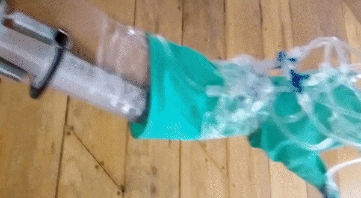

Inspired by the textures and sensations of David Lynch work, especially Blue Velvet, wanted to create mysterious, almost venomous gloves that can be both seductive and dangerous.

Each gloves evolves almost as a separate entity from their owner, slowing extending and shrinking. They are powered by a small hydrolic pump hidden under the arm of the person wearing them.

This invention also was a great excuse to discover the world of fabric wholesales in the center of Mexico City. Wandering through the alley, surrounded by those huge rolls of mulicolor fabric, I was intrigued by those silent salesmen, providing the raw material for mass market clothing.

Les Gloves of Wisdom en mouvement.

Détail des Gloves of Wisdom.

Détail des Gloves of Wisdom.

