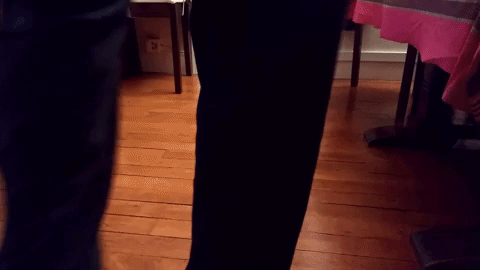

Seduction Heels are my first invention. They are a flamboyant and silly solution to a real problem.

A friend once told me she was terribly shy with a guy she had a crush on. She could not talk or act naturally in his presence. She wanted so much to grab his attention and talk to him but she was like paralyzed.

I could totally relate to her and I wanted to help somehow. That's how the Seduction Heels were born.

Anyone who wear those heels become instantly the center of attention of the party. They transform an ordinary walk into a flamboyant dance of seduction. Inspired by the peacock dance, these heels deploy colorful feathers at every footsteps. Hopefully they can get you all the attention you deserve.

[More infos here](https://medium.com/@deschamps.alix/i-made-an-invention-908be304483f)

Flowers by <a href="https://www.instagram.com/amaurybouquet/">Amaury Bouquet</a> ❤️

